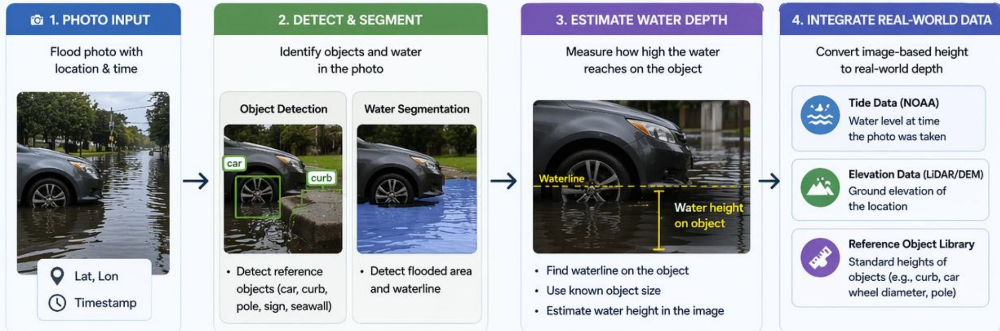
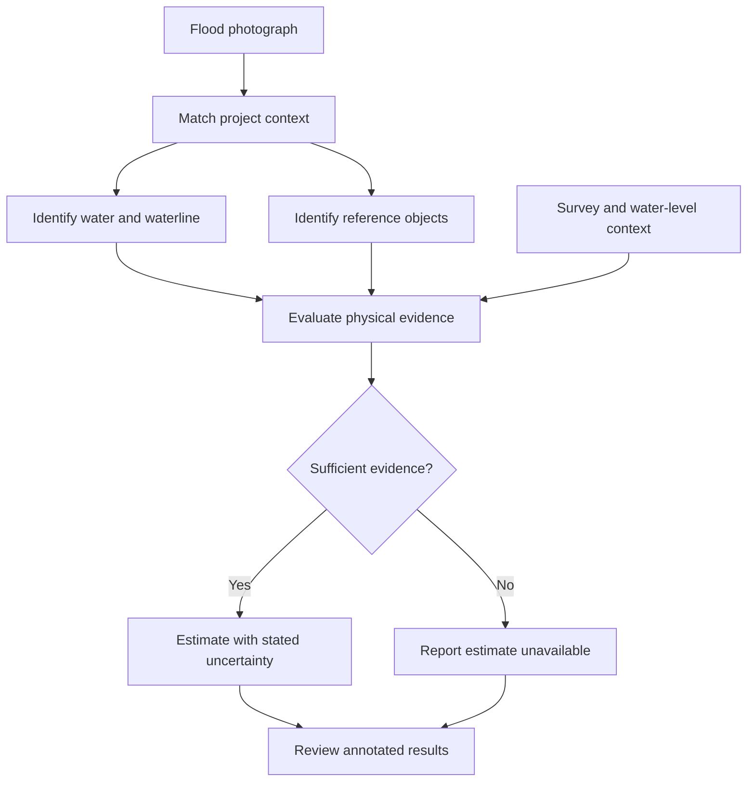
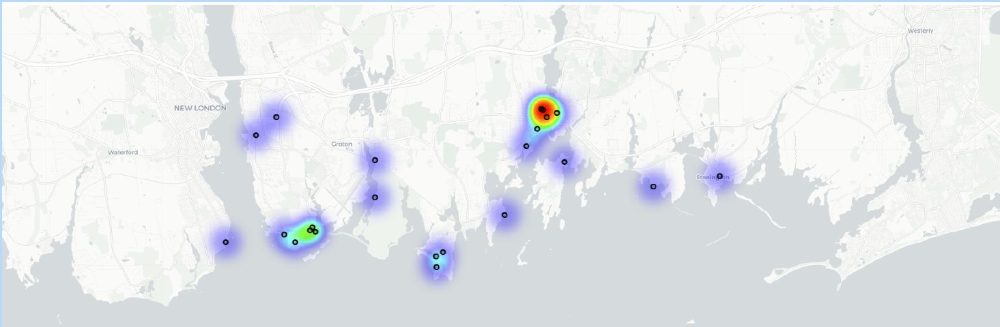
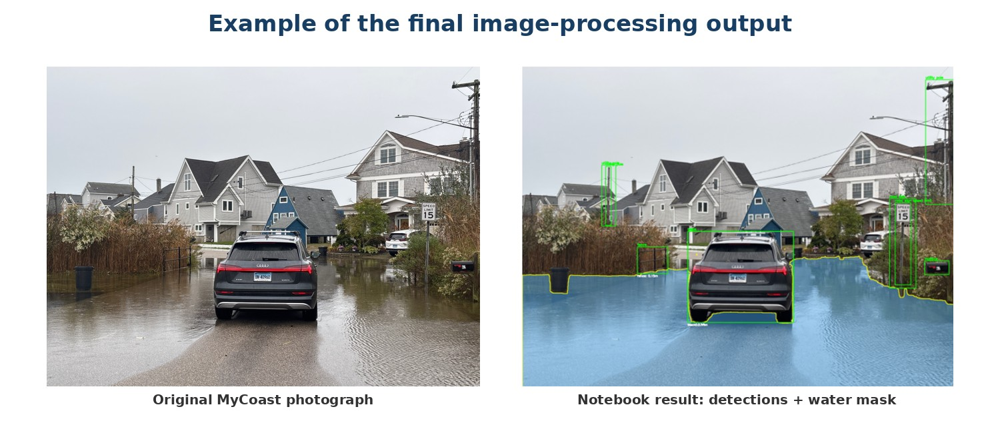

# MyCoast | Photo-Based Coastal Flood Analysis

**Python · Computer vision · Geospatial data · Uncertainty analysis · Gradio**

I developed a research workflow and interactive prototype that explore how community flood photographs can help screen local flood depth. The system combines image analysis with project metadata, potential reference objects, field-survey context, and water-level information.

**Role:** Graduate Research Assistant, Connecticut Institute for Resilience and Climate Adaptation (CIRCA)  
**Research and implementation:** Hiral Choksi  
**Advisor:** Dr. Yaprak Onat

## Why this matters

Flooding can vary from one street to another. A community photograph provides a local view that can complement tide-station information. Turning that image into a meaningful measurement requires careful interpretation of the waterline, reference objects, and physical context.

## What I built

- **Photo-analysis workflow:** match a photograph to project metadata and available environmental context.
- **Computer-vision pipeline:** identify visible water, extract waterlines, and detect potential physical reference objects.
- **Evidence-dependent estimation:** assess whether the physical basis supports a screening estimate and communicate uncertainty.
- **Interactive prototype:** analyze individual project photographs and review annotated outputs through a Gradio interface.

## Workflow

*Workflow excerpt from my project presentation. The prototype evaluates whether the physical evidence supports an estimate; it can report that a quantitative depth is unavailable.*

## Study area and example output

*Study-area map from the research report. The heat pattern shows broader MyCoast observation coverage; the final analysis uses a selected set of 18 photographs.*

*Original photograph and example image-processing output from the research report, showing detected objects and a water mask.*

## Skills demonstrated

**Computer vision:** image segmentation, object detection, and waterline analysis  
**Geospatial and environmental data:** photograph metadata, survey information, terrain context, and NOAA water levels  
**Applied research:** uncertainty, quality review, and communicating limitations  
**Application development:** an interactive Python/Gradio research interface

## Demonstration and research status

[Download the 77-second application demonstration](MyCoast_Flood_Photo_Demo.webm) (WebM, 7.7 MB) to see a photograph analyzed, the water mask and detected objects, and an example screening estimate. GitHub may require you to download the video to play it.

The displayed depth is an approximate screening estimate. This application is a research prototype, and estimates depend on the evidence available in each image. It is not an emergency-warning or life-safety system.

The research code, data, detailed methods, and unpublished findings are not included in this public showcase.

**Acknowledgment:** Work completed at CIRCA under the guidance of Dr. Yaprak Onat, with support from Connecticut Sea Grant, CIRCA, and CT NERR.
