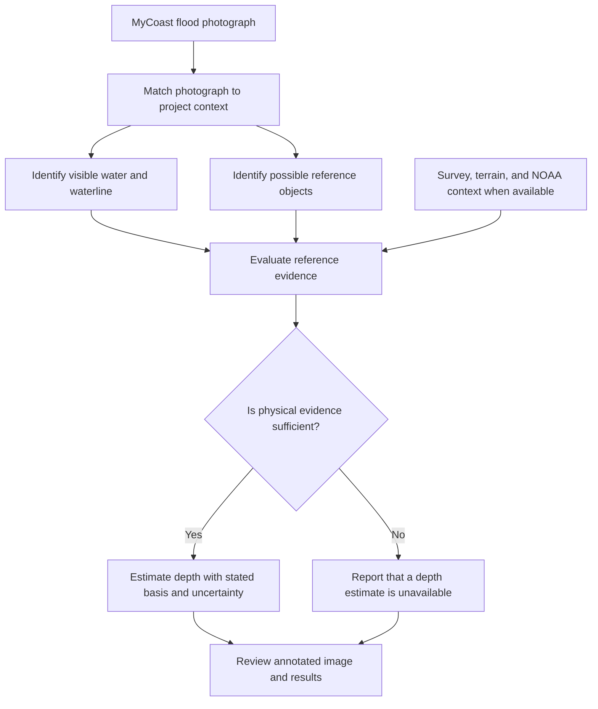

# Photo-Based Coastal Flood Analysis

**Research by Hiral Choksi | Graduate Research Assistant, CIRCA | Advisor: Dr. Yaprak Onat**

## Overview

Community photographs can provide a local view of coastal flooding where tide stations alone cannot describe conditions at a particular street. I developed a research workflow and interactive prototype that explore how flood photos, computer vision, field-survey context, and water-level information can support flood-depth screening.

I independently developed the research analysis and photo-analysis application during my graduate research assistantship at the Connecticut Institute for Resilience and Climate Adaptation (CIRCA), under the guidance of Dr. Yaprak Onat.

## Workflow

*Workflow excerpt from the project presentation. Depth estimates depend on available physical evidence and review.*

## What I built

- A workflow for matching photos with project metadata and environmental context.
- Computer-vision analysis to identify visible water, waterlines, and potential reference objects.
- An evidence-dependent depth screening approach that communicates uncertainty and withholds unsupported estimates.
- An interactive research prototype for analyzing individual photographs and reviewing outputs.

## Tools and skills

Python · computer vision · image segmentation · object detection · geospatial data · uncertainty analysis · Gradio · data visualization

## Demonstration

A video demonstration is planned for this showcase. The video will be linked after its contents and hosting are reviewed.

## Project status

This is a research prototype for screening and exploration. Estimates depend on the evidence available in each image and are not intended for emergency or life-safety decisions. Research code, detailed methods, data, and unpublished findings are private. Contact Hiral to discuss the project.

## Acknowledgments

Project advisor: Dr. Yaprak Onat. Supported by Connecticut Sea Grant, CIRCA, and CT NERR.
